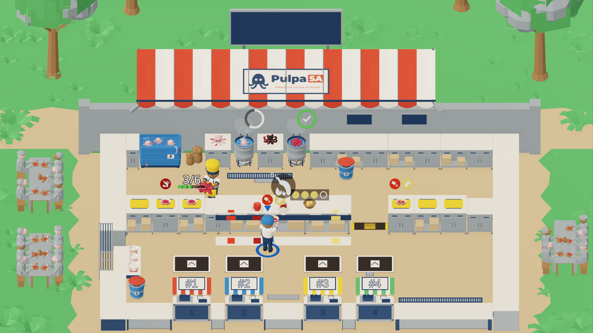

# Dirección A · «Feira Clara» — Color plano cálido y sombras suaves

Ficha: `PUL-180` (exploración de estética minimalista, M3f). Restricciones vigentes: D14 (3D, cámara ortográfica fija), D16 (licencia propia, sin assets ni imágenes de terceros), D20 (arte propio en Blender), D21 (marca **PulpaSA**), D26/D27 (lenguaje de acciones y perfil móvil a 800×370) y §3.4 de la biblia v1 (colores de condimentos y distintivos).

> **Cómo se obtuvo la imagen:** **prototipo en el motor** (`docs/evidence/PUL-180/capture_boot.gd` → `capture_minimal.gd`, estilo `dir_a`) ejecutado en tiempo de ejecución sobre `godot/scenes/levels/level_01.tscn` en Godot 4.7.2, sustituyendo en caliente los materiales por `StandardMaterial3D` de color plano sin texturas de ruido ni desgaste, ajustando `WorldEnvironment` y `DirectionalLight3D` y ocultando el atrezo secundario sin modificar ninguna escena ni recurso versionado. Capturas con HUD y móvil (800×370) en [`docs/evidence/PUL-180/direccion_a/`](../../evidence/PUL-180/direccion_a/).

---

## 1. Nombre y frase de intención

- **Nombre:** **Dirección A · «Feira Clara»** (Color plano cálido y sombras suaves).
- **Frase de intención:** *«La romería de PulpaSA limpia de ruido: materiales mates de color plano sin texturas de desgaste, luz diurna cálida con sombras suaves y siluetas amables que priorizan la lectura instantánea en PC y móvil.»*

---

## 2. Paleta cerrada en hex (16 colores)

Paleta cerrada de **16 colores en hex sRGB** (dentro del rango de 8 a 16 colores de AC2), repartida por función (`fondo`, `superficies`, `jugables`, `acentos de estado`, `UI`) e integrando los 5 colores de condimentos de §3.4:

| # | Token | Hex | Luminancia ($L$) | Rol | Uso en el nivel y la UI |
|---|---|---|---|---|---|
| 1 | `ground_sand` | `#C4A882` | 0,419 | **Fondo** | Suelo jugable de tierra de albero cálido liso (Z0) y cajas de cartón secundarias |
| 2 | `stone_steel` | `#8C96A0` | 0,300 | **Fondo / Superficie** | Muro de sillares de granito liso (Z3) y frentes metálicos mates de encimeras, ollas y estantería (Z2) |
| 3 | `surface_top` | `#EDE8DF` | 0,811 | **Superficie** | Tablero superior de encimeras (Z1), placa clara de la estación de condimentos, fondo interior de la bandeja (`tray_liner`) y borde de paneles UI |
| 4 | `brand_navy` | `#1D3557` | 0,035 | **Superficie / Jugable / UI** | Color principal **PulpaSA**: cuerpo de kioscos, zócalos oscuros, pantalón de cocineros y panel/cabecera de UI |
| 5 | `brand_red` | `#C8402F` | 0,148 | **Jugable / UI** | Acento **PulpaSA**: bandeja/caja jugable, rayas rojas del toldo, toldillo del puesto 1 y barra de paciencia en UI |
| 6 | `player_blue` | `#2F6FB5` | 0,159 | **Jugable** | Gorra/delantal y aro activo de J1, toldillo del puesto 2 y tanque/agua de pulpo |
| 7 | `fair_green` | `#4FA05A` | 0,296 | **Jugable / Fondo** | Toldillo del puesto 4 y bloques planos de vegetación y pradera exterior (Z3) |
| 8 | `octopus_raw` | `#E0AFB2` | 0,501 | **Acento de estado** | Pulpo crudo en tanque, mano y encimera (rosa pálido) |
| 9 | `octopus_cooked` | `#B8283D` | 0,117 | **Acento de estado** | Pulpo cocido entero y rodajas cortadas dentro de la caja (rojo-morado saturado) |
| 10 | `potato_raw` | `#8E6B47` | 0,166 | **Acento de estado / Superficie** | Patata cruda con piel, saco de la cachelera, cuenco de barro y bancos de madera exteriores |
| 11 | `state_burnt` | `#2A2320` | 0,018 | **Acento de estado / UI** | Pulpo y cachelo quemados (carbón), rejillas de suelo, pozos de cifras (`DisplayWell`) y tinta `StickerInk` |
| 12 | `paprika_sweet` | `#D6361F` | 0,170 | **Jugable / §3.4** | **Pimentón / aliño dulce** (§3.4): cuerpo de dispensador dulce, etiqueta, pegatina de caja e icono de ticket |
| 13 | `paprika_hot` | `#8F1A14` | 0,066 | **Jugable / §3.4** | **Pimentón / aliño picante** (§3.4): cuerpo de dispensador picante, etiqueta, pegatina de caja e icono de ticket |
| 14 | `salt_paper` | `#F7F4EC` | 0,905 | **Jugable / §3.4 / UI** | **Sal gorda** (§3.4), camisa de cocineros, rayas claras del toldo, placa de número de puesto y texto principal de UI |
| 15 | `oil_amber` | `#F2C230` | 0,577 | **Jugable / §3.4 / Estado** | **Aceite** (§3.4), gorro/delantal y aro de J2, toldillo del puesto 3, marcas de pasaplatos y aviso ámbar |
| 16 | `cachelos_cooked` | `#F2D56B` | 0,675 | **Jugable / §3.4 / Estado** | **Cachelo cocido y pegatina de cachelos** (§3.4) en cuenco, interior de caja y ticket |

---

## 3. Reglas de forma, material, luz y post-proceso

- **Forma y geometría:**
  - Se conserva la silueta redondeada y estilizada de los objetos de gameplay (cocineros, pulpos, cachelos, ollas, cajas y puestos), con biseles amplios (2–3 cm) para que las caras superior (`+Y`) y frontal (`-Z`) se separen por cambio de plano de luz.
  - Presupuesto objetivo reducido a la mitad respecto a v2: **≤ 45 000 triángulos** en pantalla (frente a los 80 100 medidos en v2), eliminando geometría de cables, bombillas, charcos y desorden perimetral.
- **Materiales (`StandardMaterial3D` de color plano):**
  - **Cero texturas de ruido, desgaste, arañazos, mapas de normales u ORM.** Cada superficie usa exclusivamente `albedo_color` de la tabla de §2 con `specular_mode = SPECULAR_DISABLED` y `metallic = 0.0` (`roughness` entre `0.65` en comida/bandejas y `0.92` en suelo/muros).
  - Esto erradica de raíz los problemas D5/D6 (239 recursos de material duplicados y 410 PNG importados en v2) y D7 (manchas blancas especulares sobre las encimeras delanteras) detectados en `PUL-087`.
  - Las únicas texturas permitidas son los **iconos vectoriales/atlas de señalética y marca** (`pulpasa_horizontal`, `pulpasa_compacta`, iconos de verbos D26 e iconos de condimentos §3.4).
- **Luz y post-proceso:**
  - **Sol (`DirectionalLight3D`):** cálido suave (`#FFF4E0`), energía `1.18`, sombras activadas y blandas (`shadow_blur = 3.2`) que proyectan volumen sin oscurecer ninguna superficie jugable por debajo de $L = 0,15$.
  - **Ambiente (`WorldEnvironment`):** color uniforme `#EDE8DF` con energía `0.72` para levantar las caras en sombra y mantener el aspecto de feria de día.
  - **Luces puntuales (`OmniLight3D`):** **0 luces puntuales activas** (se apagan las 5 bombillas de la v2).
  - **Post-proceso:** SSAO suave de contacto (`radius = 0.45`, `intensity = 1.1`), **glow desactivado**, **viñeta desactivada** y **tilt-shift desactivado**.

---

## 4. Qué atrezo desaparece o se simplifica

| Zona | Qué desaparece por completo | Qué se conserva simplificado en color plano |
|---|---|---|
| **Z0 · Suelo jugable** | Decals de charcos (`env_puddle`), rodadas de neumático (`env_track`), piedrecitas y hojas pintadas (`ground_w_decals`, `ground_e_decals`). | Losa continua de albero `#C4A882` y las 3 rejillas de desagüe en `#2A2320`. |
| **Z1 · Superficies de juego** | Tablas de corte y cuchillos decorativos (`props_board`), jarras/cuncas sobre encimeras (`props_crock`), etiquetas obsoletas de sal/aceite sueltos en la estación de condimentos (`*_oil`, `*_salt`) y paneles S/M/L de la estantería (`SizePanel_*`, `labels`). | Tableros limpios en `#EDE8DF`, marcas de los 6 pasaplatos en `#F2C230` y los 3 puntos activos de la estación (aliño dulce `#D6361F`, aliño picante `#8F1A14` y cuenco de cachelos `#F2D56B`). |
| **Z2 · Frentes y estaciones** | Bombonas y mangueras de gas traseras (`gas_bottle`), bomba exterior del tanque (`pump`), cajas de cartón bajo el rack (`cartons`). | Frentes lisos en `#8C96A0` con zócalo `#1D3557`, toldillos de puestos en color plano (`#C8402F`, `#2F6FB5`, `#F2C230`, `#4FA05A`) y placa de comanda en papel `#F7F4EC` con marco `#1D3557`. |
| **Z3 · Fondo y entorno** | Guirnaldas y cables (`*_garlands`, `tent_bulbs`), valla metálica (`*_fence`), generador, bidones, bombonas y montones de sacos/cajas (`back_*_props`, `props_*_props`). | Toldo a rayas `#C8402F`/`#F7F4EC` con el cartel oficial **PulpaSA**, muro de granito liso `#8C96A0`, bloques de vegetación en `#4FA05A` y mesas laterales de romería en `#8E6B47`. |

---

## 5. Cómo se leen los estados y los colores de §3.4

### 5.1 Lectura de estados de comida y caja
- **Pulpo crudo (`#E0AFB2`, $L = 0,501$) → cocido (`#B8283D`, $L = 0,117$) → quemado (`#2A2320`, $L = 0,018$):**
  - Contraste **crudo / cocido = 3,30 : 1** ($\ge 3:1$) + cambio de silueta (patas extendidas vs rizadas).
  - Contraste **crudo / quemado = 8,10 : 1** ($\ge 3:1$) y **cocido / quemado = 2,45 : 1** + humo oscuro y silueta encogida.
  - Sobre el tablero claro de encimera (`#EDE8DF`, $L = 0,811$), el cocido destaca a **5,16 : 1** y el quemado a **12,66 : 1**; el crudo se separa por saturación rosada, sombra de contacto SSAO y el anillo/barra de mundo.
- **Patata cruda (`#8E6B47`, $L = 0,166$) → cachelo cocido (`#F2D56B`, $L = 0,675$) → quemado (`#2A2320`, $L = 0,018$):**
  - Contraste **crudo / cocido = 3,36 : 1** ($\ge 3:1$), **cocido / quemado = 10,67 : 1** y **crudo / quemado = 3,17 : 1**.
- **Caja vacía, a medias y llena:**
  - El cuerpo exterior rojo (`#C8402F`) enmarca el fondo interior claro (`#EDE8DF`, contraste **3,34 : 1**). Al cortar pulpo (1..6 cortes, contador `%CutCounter` visible sobre la caja), las capas de rodajas `#B8283D` llenan el fondo claro con **5,16 : 1** de contraste; al añadir cachelos (`#F2D56B`), estos descansan sobre la cama de pulpo `#B8283D` con **4,34 : 1** de contraste.

### 5.2 Contraste de los 5 colores de §3.4 (requisito AC2 ≥ 3:1)

En la Dirección A, cada color de §3.4 aparece sobre una superficie de soporte de polaridad opuesta:
- Los **2 condimentos oscuros** (`paprika_sweet` `#D6361F` y `paprika_hot` `#8F1A14`) se apoyan siempre sobre la **superficie clara** `#EDE8DF` (alfombrilla y collar de dispensador en la estación, fondo de la bandeja y pastilla clara en UI/pegatinas).
- Los **3 condimentos claros** (`salt_paper` `#F7F4EC`, `oil_amber` `#F2C230` y `cachelos_cooked` `#F2D56B`) se apoyan siempre sobre **superficie oscura** (`#1D3557` zócalo/panel UI, `#8E6B47` cuenco de barro, `#B8283D` cama de pulpo cocido en la caja o `#2A2320` anillo `StickerInk`).

| Color de §3.4 | Hex | $L$ | Superficie donde aparece en Dirección A | Hex superficie ($L$) | Contraste medido | Cumple ≥ 3:1 | Cómo se distingue del resto de §3.4 |
|---|---|---|---|---|---|---|---|
| **Pimentón dulce** | `#D6361F` | 0,170 | Placa/tablero claro de estación y bandeja | `#EDE8DF` (0,811) | **3,91 : 1** | Sí | Rojo vivo ($L=0,17$) + icono de pimentonera (sin llama); 3,29:1 vs cachelos y 4,34:1 vs sal |
| **Pimentón picante** | `#8F1A14` | 0,066 | Placa/tablero claro de estación y pastilla UI | `#EDE8DF` (0,811) | **7,40 : 1** | Sí | Granate oscuro ($L=0,07$) + icono de guindilla + marca `hot_mark` (D26.7); 5,39:1 vs aceite, 6,24:1 vs cachelos y 8,21:1 vs sal |
| **Sal gorda** | `#F7F4EC` | 0,905 | Panel/zócalo marino, cama de pulpo y anillo `StickerInk` | `#1D3557` (0,035) / `#B8283D` (0,117) | **11,24 : 1** (5,72 : 1 en caja) | Sí | Blanco cálido ($L=0,91$) con anillo oscuro `#2A2320` (14,05:1) + icono de copos |
| **Aceite** | `#F2C230` | 0,577 | Zócalo marino, cama de pulpo y pozo oscuro | `#1D3557` (0,035) / `#B8283D` (0,117) | **7,38 : 1** (3,75 : 1 en caja) | Sí | Ámbar dorado ($L=0,58$) + icono de gota |
| **Cachelos** | `#F2D56B` | 0,675 | Zócalo marino, cuenco `#8E6B47` y cama de pulpo `#B8283D` | `#1D3557` (0,035) / `#8E6B47` (0,166) / `#B8283D` (0,117) | **8,54 : 1** (3,36 : 1 en cuenco, 4,34 : 1 en caja) | Sí | Amarillo patata ($L=0,68$) + trozos facetados + icono de patata |

---

## 6. Impacto en la UI y el HUD

- **Tickets de comanda (`OrderTicketsPanel`) y HUD (`HUD`):**
  - El cuerpo del panel usa `brand_navy` (`#1D3557`, opacidad 100 %, sin transparencias borrosas) con borde limpio de 2 px en `#EDE8DF` y radio de esquina de 4 px.
  - La cabecera (`UiHeader`) y los pozos de reloj/recaudación (`DisplayWell`) usan `#2A2320` para dar un contraste de **14,05 : 1** al texto `#F7F4EC` y **9,22 : 1** a las cifras en `#F2C230`.
  - La franja superior de cada ticket (`%Stripe`) usa exactamente el color plano del toldillo de su puesto (`#C8402F`, `#2F6FB5`, `#F2C230`, `#4FA05A`).
- **Móvil a 800×370 (D26/D27):**
  - Al desaparecer el ruido de suelo (charcos y rodadas) y los brillos blancos de las encimeras, los anillos de cocción (`%CookRing`), el contador de corte (`3/6`), los prompts de acción D26 (`≥ 64 px` a 1080p) y los botones táctiles en fila (D27) ganan nitidez inmediata sin cambiar su layout ni sus márgenes de safe area.
