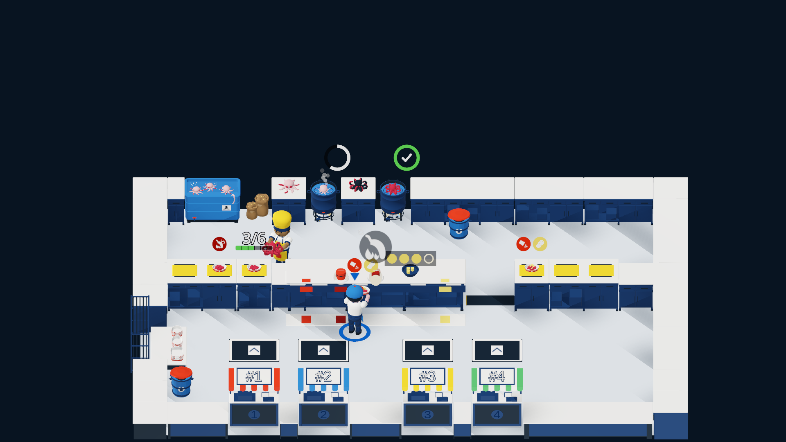

# Dirección B · «Bloques de Romería» (Formas geométricas puras y paleta reducida)

> **Cómo se obtuvo la imagen:** **Prototipo en el motor** ejecutado en tiempo de ejecución mediante
> `docs/evidence/PUL-180/capture_boot.gd` → `docs/evidence/PUL-180/capture_minimal.gd` sobre la
> escena `godot/scenes/main/main.tscn`, sin modificar ninguna escena ni recurso versionado. Capturas
> adicionales (sin HUD a `1920×1080` y vista móvil a `800×370`) en
> `docs/evidence/PUL-180/direccion_b/`.

---

## 1. Nombre y frase de intención

**Dirección B — «Bloques de Romería»:** *Abstraer la cocina del pulpo en volúmenes geométricos puros
de juguete arquitectónico sobre un escenario azul noche de contraste extremo, reduciendo la escena a
siluetas primarias donde solo hablan la geometría y el código cromático de los pedidos.*

---

## 2. Paleta cerrada en hex (14 colores)

Paleta estricta de **14 colores** (dentro del rango de 8 a 16 colores de AC2), diseñada para que el
escenario funcione como una caja negra/azul profundo sobre la que destacan las encimeras de piedra
clara y los 5 colores normativos de §3.4:

| # | Rol / Categoría | Token | Hex | Luminancia rel. ($L$) | Uso principal |
|---:|---|---|---|---:|---|
| 1 | Fondo / Entorno | `bg_void_navy` | `#18222C` | 0.0170 | Cielo/vacío exterior, recorte de silueta y fondo de iconos oscuros |
| 2 | Superficie | `surf_slate_floor` | `#243240` | 0.0315 | Losa geométrica del suelo de la cocina y faldón estructural |
| 3 | Superficie | `surf_stone_block` | `#EFECE6` | 0.8351 | Bloque superior de encimeras de los 4 puestos, barra y bandeja interior |
| 4 | Superficie | `surf_steel_dark` | `#465666` | 0.0898 | Bastidores cúbicos de los puestos, cuerpo de la barra y cilindro de las ollas |
| 5 | Jugable (personaje) | `play_cook_1_coral` | `#E63946` | 0.1932 | Cocinero 1 (gorro/delantal geométrico y aro de suelo P1) |
| 6 | Jugable (personaje) | `play_cook_2_cyan` | `#2A9D8F` | 0.2782 | Cocinero 2 (gorro/delantal geométrico y aro de suelo P2) |
| 7 | Jugable / UI | `play_box_navy` | `#1D3557` | 0.0365 | Cuenco de aliños claros, fondo de tarjeta HUD y pastilla de estación |
| 8 | Jugable / Estado | `state_octopus_cooked` | `#B8283D` | 0.1046 | Pulpo cocido y ración lista (`cooked_cut`) en caja |
| 9 | Estado | `state_timer_ok` | `#2E9E5B` | 0.2768 | Progreso de cocción óptima y confirmación de entrega |
| 10 | §3.4 Condimento | `sec34_paprika_sweet` | `#D6361F` | 0.1703 | Pimentón dulce (pegatina circular, cuenco y espolvoreado) |
| 11 | §3.4 Condimento | `sec34_paprika_hot` | `#8F1A14` | 0.0663 | Pimentón picante (pegatina octogonal, cuenco y espolvoreado) |
| 12 | §3.4 Condimento | `sec34_salt` | `#F7F4EC` | 0.9053 | Sal gruesa (pegatina cuadrada, cuenco, cristales y texto HUD) |
| 13 | §3.4 Condimento | `sec34_oil` | `#F2C230` | 0.5767 | Aceite de oliva (pegatina en gota, aceitera, brillo y ámbar de peligro) |
| 14 | §3.4 Condimento | `sec34_cachelos` | `#F2D56B` | 0.6753 | Cachelos (pegatina ovalada, gajos geométricos en caja y puesto) |

> **Nota sobre estados derivados de la misma paleta:** El pulpo crudo usa una mezcla tonal fría de
> `surf_steel_dark` (`#465666`) con subtono malva; el pulpo quemado cae directamente al carbón
> `bg_void_navy` (`#18222C`), fundiéndose con el vacío oscuro como señal inequívoca de pérdida.

---

## 3. Reglas de forma, material, luz y post-proceso

- **Forma:**
  - **Primitivas puras sin biseles decorativos:** los puestos son paralelepípedos limpios (cuerpo
    `#465666` + losa `#EFECE6`); las ollas son cilindros ortogonales sin remaches ni asas barrocas;
    los ingredientes se sintetizan en esferas, cilindros cortos y prismas octogonales (fieles a la
    geometría de su pegatina en D26).
  - **Chasis de estación por forma geométrica:** cada uno de los 4 puestos se distingue por una
    pieza volumétrica primaria sobre la losa `#EFECE6` (cilindro alto en `Freezer`, bloque escalonado
    con cuchilla en `CuttingBoard`, gradilla de prismas en `SpiceRack`, dispensador cúbico en
    `BoxDispenser`).
- **Material:**
  - `StandardMaterial3D` 100 % sin texturas (`albedo_texture = null`, `normal_enabled = false`),
    con sombreado difuso duro o *toon* de 2 escalones y acabado mate uniforme (`roughness = 0.82`,
    `metallic = 0.08`, `specular = 0.15`).
  - Cero reflejos especulares puntuales: las superficies responden como bloques de madera lacada o
    resina mate.
- **Luz:**
  - **Una única `DirectionalLight3D`** cenital-frontal con sombras más marcadas (`shadow_blur = 1.0`,
    `shadow_opacity = 0.72`) que proyecta bloques de sombra limpios sobre la losa `#243240`.
  - **0 `OmniLight3D`** de entorno. Iluminación ambiental plana (`ambient_light_color = #18222C`,
    `ambient_light_energy = 0.45`) para preservar el contraste dramático entre la isla de cocina y
    el fondo `#18222C`.
- **Post-proceso:**
  - Sin bloom, sin niebla, sin viñeta ni DoF. El recorte de la plataforma de juego contra el vacío
    `#18222C` sustituye cualquier marco óptico y dirige el 100 % de la atención al rectángulo de
    trabajo.

---

## 4. Qué atrezo desaparece o se simplifica

| Elemento actual (v2) | Destino en Dirección B | Justificación de diseño |
|---|---|---|
| **Todo el perímetro exterior (16 props de fondo + muralla + árboles + colinas)** | **Eliminado por completo** | La cocina flota como un diorama/tablero aislado sobre `#18222C` (estilo *Overcooked* espacial o *Mini Motorways* 3D), eliminando el 100 % del ruido periférico. |
| **Carpa a rayas y estructura de postes (`TentA` / `TentFrame`)** | **Eliminado** | Desaparecen las columnas y la lona superior; nada compite con los números `#1..#4` de la barra de entrega. |
| **Guirnalda (`Garland`) y farolillos (`Lanterns`)** | **Eliminado** | Sin luces puntuales ni cables que crucen el encuadre. |
| **Utensilios realistas en puestos (tijeras detalladas, botes con etiquetas, pilas de cajas)** | **Simplificados a 1 icono volumétrico por puesto** | Cada estación conserva un único volumen geométrico clave en la paleta cerrada. |
| **Detalle anatómico del pulpo (ventosas, tentáculos rizados)** | **Simplificado a geometría modular** | Crudo/cocido como cúpula con 4-6 cilindros cortos; cortado (`cooked_cut`) como discos cilíndricos limpios dentro de la caja. |

---

## 5. Cómo se leen los estados y los colores de §3.4

### 5.1 Lectura de estados de juego
- **Pulpo crudo (`raw`):** bloque cilíndrico-esférico en gris acero frío (`#465666`), claramente
  inactivo frente a la encimera `#EFECE6`.
- **Pulpo cocido (`cooked` / `cooked_cut`):** rojo burdeos (`#B8283D`) de silueta rotunda; en la
  olla se acompaña de la barra circular verde `#2E9E5B` y en la tabla pasa de volumen entero a
  discos geométricos regulares.
- **Pulpo quemado (`burned`):** bloque negro azulado (`#18222C`, igual que el vacío) más icono
  octogonal de alerta en ámbar `#F2C230` y humo oscuro en esferas low-poly.
- **Caja vacía vs. caja llena:** la caja vacía muestra su interior blanco piedra (`#EFECE6`,
  $L = 0.8351$); al llenarse con ración (`#B8283D`, $L = 0.1046$), el centro pasa de claro a oscuro
  con un **contraste de 6.01:1**.
- **Aliños (§3.4):** cada condimento se representa en el puesto, en la caja y en el HUD con **la
  misma forma geométrica y color hex** (D26): círculo `#D6361F`, octógono `#8F1A14`, cuadrado
  `#F7F4EC`, gota `#F2C230` y óvalo `#F2D56B`.

### 5.2 Contraste WCAG 2.1 de los 5 colores de §3.4 (AC2: requisito ≥ 3:1)

En la Dirección B, los condimentos oscuros se apoyan sobre el bloque de piedra clara (`#EFECE6`) y
los condimentos claros se apoyan sobre los soportes oscuros (`#1D3557` / `#18222C`) o sobre el
pulpo cocido (`#B8283D`). Tabla calculada en `docs/evidence/PUL-180/contrastes_sec34.md`:

| Condimento (§3.4) | Hex | $L$ condimento | Superficie donde aparece | Hex superficie | $L$ superficie | Contraste (WCAG) | Cumple ≥ 3:1 |
|---|---|---:|---|---|---:|---:|:---:|
| **Pimentón dulce** (`paprika_sweet`) | `#D6361F` | 0.1703 | Losa de encimera / interior de caja | `#EFECE6` | 0.8351 | **4.04 : 1** | Sí |
| **Pimentón picante** (`paprika_hot`) | `#8F1A14` | 0.0663 | Losa de encimera / interior de caja | `#EFECE6` | 0.8351 | **7.66 : 1** | Sí |
| **Sal gruesa** (`salt`) | `#F7F4EC` | 0.9053 | Cuenco / pastilla HUD (`play_box_navy`) | `#1D3557` | 0.0365 | **11.24 : 1** | Sí |
| **Sal gruesa** (`salt`) | `#F7F4EC` | 0.9053 | Fondo oscuro (`bg_void_navy`) / pulpo (`#B8283D`) | `#18222C` / `#B8283D` | 0.0170 / 0.1046 | **14.12 : 1** / **6.14 : 1** | Sí |
| **Aceite de oliva** (`oil`) | `#F2C230` | 0.5767 | Cuenco / pastilla HUD (`play_box_navy`) | `#1D3557` | 0.0365 | **7.38 : 1** | Sí |
| **Aceite de oliva** (`oil`) | `#F2C230` | 0.5767 | Fondo oscuro (`bg_void_navy`) / pulpo (`#B8283D`) | `#18222C` / `#B8283D` | 0.0170 / 0.1046 | **9.26 : 1** / **4.03 : 1** | Sí |
| **Cachelos** (`cachelos`) | `#F2D56B` | 0.6753 | Cuenco / pastilla HUD (`play_box_navy`) | `#1D3557` | 0.0365 | **8.54 : 1** | Sí |
| **Cachelos** (`cachelos`) | `#F2D56B` | 0.6753 | Fondo oscuro (`bg_void_navy`) / pulpo (`#B8283D`) | `#18222C` / `#B8283D` | 0.0170 / 0.1046 | **10.72 : 1** / **4.67 : 1** | Sí |

---

## 6. Impacto en la UI y el HUD

- **Fusión total entre fondo y HUD:** al ser el exterior del escenario `#18222C`, las tarjetas de
  pedidos en la franja superior y los marcadores de puntuación se leen sobre un fondo oscuro
  absolutamente limpio (0 elementos 3D detrás del HUD superior), lo que multiplica la velocidad de
  lectura en móvil (`800×370`).
- **Lenguaje geométrico unificado 3D ↔ 2D:** las tarjetas de pedido usan bloques rectangulares sin
  redondeo (`corner_radius = 2 px`) con borde `#465666` y fondo `#1D3557`, replicando exactamente
  la arquitectura en bloques de las estaciones 3D.
- **Números de ranura (`#1..#4`) en la barra:** al desaparecer la carpa y quedar el borde superior
  de la cocina contra el suelo `#243240` y el vacío `#18222C`, los números `#F7F4EC` sobre pastilla
  `#1D3557` alcanzan **11.24:1** de contraste sin interferencia de geometría de fondo.
