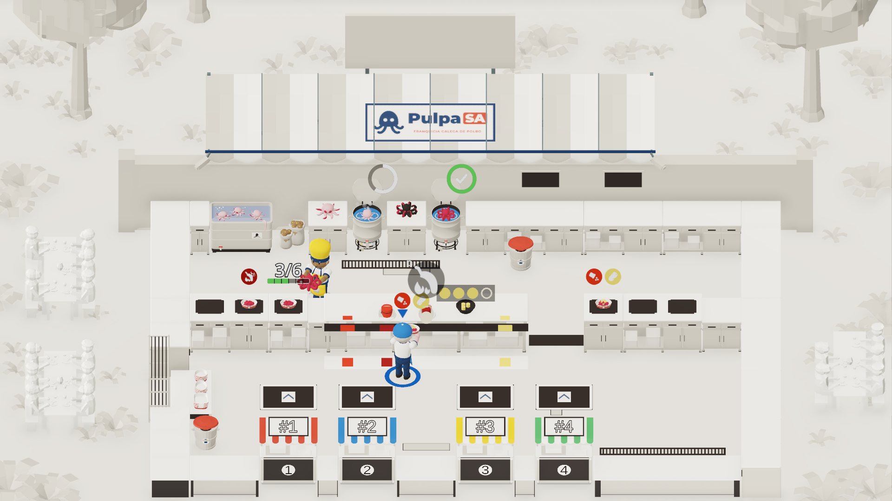

# Dirección C · «Maqueta de Papel» (Maqueta arquitectónica blanca con acentos en lo jugable)

> **Cómo se obtuvo la imagen:** **Prototipo en el motor** ejecutado en tiempo de ejecución mediante
> `docs/evidence/PUL-180/capture_boot.gd` → `docs/evidence/PUL-180/capture_minimal.gd` (estilo `dir_c`)
> sobre la escena `godot/scenes/levels/level_01.tscn`, sin modificar ninguna escena ni recurso
> versionado. Capturas adicionales (con HUD a `1920×1080` y vista móvil a `800×370`) en
> `docs/evidence/PUL-180/direccion_c/`.

---

## 1. Nombre y frase de intención

**Dirección C — «Maqueta de Papel»:** *Convertir el escenario en una maqueta arquitectónica de
cartulina marfil y grafito suave donde el mundo no interactivo es monocromo y el color está
estrictamente reservado a los cocineros, el pulpo, las cajas, los puestos y los 5 condimentos de §3.4.*

---

## 2. Paleta cerrada en hex (15 colores)

Paleta cerrada de **15 colores** (dentro del rango de 8 a 16 colores de AC2), alineada con el prototipo
ejecutado en `docs/evidence/PUL-180/capture_minimal.gd` (`dir_c` y tabla compartida `common`) y dividida
en **4 neutros de cartulina/tinta** para el mundo estático y **11 colores semánticos** para los
elementos jugables y el HUD. Luminancias relativas ($L$) calculadas con `docs/evidence/PUL-180/build_evidence.py`:

| # | Rol / Categoría | Token | Hex (prototipo `capture_minimal.gd`) | Luminancia rel. ($L$) | Uso principal en el prototipo (y variante conceptual si difiere) |
|---:|---|---|---|---:|---|
| 1 | Fondo / Maqueta | `paper_bg_ivory` | `#E4DFD5` | 0.7407 | Fondo `background_color` (`capture_minimal.gd:414`), suelo de cocina (`kitchen_floor_dirt`), terreno exterior y cartón (`:610-612, 638`) *(variantes conceptuales: `#F4EFE6`, $L = 0.8668$ y `#E6DFD3`, $L = 0.7430$)* |
| 2 | Superficie | `paper_cardboard_mid` | `#CBC5B9` | 0.5613 | Frentes de encimeras, muro de granito, rayas de la carpa, árboles/helechos y sacos en cartón gris cálido (`capture_minimal.gd:613-625, 633-646`) *(variante conceptual: `#D5CCB9`, $L = 0.6083$)* |
| 3 | Superficie / §3.4 | `paper_counter_white` | `#F7F4EC` | 0.9053 | Superficie superior de encimeras, barra, interior de caja, mesas de fondo (`:667`), luz ambiental (`:416`), cuerpo de tickets HUD (`:805`) y **sal gruesa (§3.4)** |
| 4 | Superficie / Tinta | `ink_graphite_dark` | `#2A2320` | 0.0180 | Ollas en grafito mate, cuenco y soporte oscuro de estación (`:619, 635, 701`), pulpo/patata quemados (`:502, 505`), bordes y texto de tickets HUD (`:807-809`) |
| 5 | Jugable / Marca / UI | `brand_navy` | `#1D3557` | 0.0350 | Pantalón de cocineros (`mat_cloth_pants`, `:511`) y cabecera de tarjetas HUD (`UiHeader`, `:806`) |
| 6 | Jugable | `brand_red` | `#C8402F` | 0.1615 | Exterior de la caja de ración (`mat_plastic_red`, `:623`) y toldillo del puesto 1 (`mat_canvas_stand_1`, `:627`) |
| 7 | Jugable (personaje / puesto) | `play_cook_1_blue` | `#2F6FB5` | 0.1531 | **Cocinero 1** (`mat_cloth_player_1`: gorra/delantal azul y aro P1 en `capture_minimal.gd:508`), toldillo del puesto 2 (`:628`) y agua (`:640-641`) *(variante conceptual bermellón P1: `#E04836`, $L = 0.2075$; cobalto P2: `#2B72B8`, $L = 0.1601$)* |
| 8 | Jugable / Estado | `stand_4_green` | `#4FA05A` | 0.2754 | Toldillo del puesto 4 (`mat_canvas_stand_4`, `:630`) y anillo de cocción lista |
| 9 | Jugable / Estado | `state_octopus_raw` | `#E0AFB2` | 0.4972 | Pulpo crudo (`mat_food_octopus_raw`, `:499`) y piel clara (`mat_skin_light`, `:512`) *(variante conceptual malva para mayor contraste sobre blanco: `#9E7B9B`, $L = 0.2380$)* |
| 10 | Jugable / Estado | `state_octopus_cooked` | `#B8283D` | 0.1204 | Pulpo cocido (`cooked` / `cooked_cut`) en olla, encimera y caja (`:500-501, 506`) |
| 11 | Jugable / Estado | `potato_raw` | `#8E6B47` | 0.1672 | Patata cruda (`mat_food_potato_raw`, `:503`) y piel oscura (`mat_skin_dark`, `:513`) |
| 12 | §3.4 Condimento | `sec34_paprika_sweet` | `#D6361F` | 0.1703 | **Pimentón dulce** (§3.4: círculo, dispensador y etiqueta) |
| 13 | §3.4 Condimento | `sec34_paprika_hot` | `#8F1A14` | 0.0663 | **Pimentón picante** (§3.4: octógono, dispensador y etiqueta) |
| 14 | §3.4 Condimento / Jugable | `sec34_oil` | `#F2C230` | 0.5767 | **Aceite de oliva** (§3.4: gota), **Cocinero 2** (`mat_cloth_player_2`: gorro/delantal amarillo en `capture_minimal.gd:509`) y toldillo del puesto 3 (`:629`) |
| 15 | §3.4 Condimento | `sec34_cachelos` | `#F2D56B` | 0.6753 | **Cachelos** (§3.4: óvalo y gajos en caja/cuenco, `:504, 507`) |

> **Nota sobre alineación entre documento y prototipo (`capture_minimal.gd`):** En `capture_minimal.gd`
> el fondo y suelo usan `#E4DFD5` (`:414, 610`) con frentes `#CBC5B9` (`:617`), y los cocineros
> comparten la tabla `common` (`#2F6FB5` azul para el Cocinero 1 en `:508` y `#F2C230` amarillo para
> el Cocinero 2 en `:509`, tal como se ve en las capturas). Se dejan documentadas entre paréntesis las
> variantes conceptuales alternativas (`#F4EFE6`/`#E6DFD3`/`#D5CCB9` en papel, `#E04836`/`#2B72B8` en
> cocineros y `#9E7B9B` en pulpo crudo). El color `#F7F4EC` cumple doble función intencionada (blanco
> hueso del papel de encimera y blanco sal de §3.4 sobre soporte grafito `#2A2320` o azul `#1D3557`).

---

## 3. Reglas de forma, material, luz y post-proceso

- **Forma:**
  - **Estética de cartulina plegada / *papercraft* arquitectónico:** los puestos, la barra, la
    carpa y el entorno (árboles, muro y mesas de comensales) se leen como maquetas de cartón pluma
    monocromas (`#F7F4EC` arriba, `#CBC5B9` en frentes y `#E4DFD5` en el suelo), mientras que las
    ollas y soportes de estación usan grafito oscuro (`#2A2320`).
  - **Jerarquía cromática estricta (regla 90/10):** el entorno estático permanece en la escala
    marfil-cartón-grafito (`#E4DFD5`, `#CBC5B9`, `#F7F4EC`, `#2A2320`), reservando los colores
    saturados a los elementos de gameplay (cocineros, comida, cajas, toldillos de puestos y §3.4) y
    a la placa `env_plate` de **PulpaSA** en el toldo (`capture_minimal.gd:685`).
- **Material:**
  - Acabado mate de papel/cartón (`roughness = 0.90–0.95`, `metallic = 0.0`,
    `specular_mode = SPECULAR_DISABLED`) en las superficies del escenario y estaciones.
  - Los elementos de comida mantienen `roughness = 0.55–0.65` para diferenciarse del cartón mate.
- **Luz (`capture_minimal.gd:408-417`):**
  - **Luz de estudio cenital difusa:** 1 `DirectionalLight3D` blanca (`#FFFFFF`,
    `light_energy = 1.05`) con sombras suaves (`shadow_blur = 2.6`), fondo `background_color = #E4DFD5`
    y luz ambiental alta (`ambient_light_color = #F7F4EC`, `ambient_light_energy = 0.85`).
  - **0 `OmniLight3D`** de feria (`bulbs.visible = false`).
- **Post-proceso (`capture_minimal.gd:367-374, 418-425`):**
  - Se desactivan el `glow` (`glow_enabled = false`), el DoF (`camera_attributes = null`), el mapa de
    corrección tonal y la capa `Vignette` (`vignette.visible = false`), pero **se activa un SSAO
    marcado en los pliegues** (`ssao_enabled = true`, `ssao_radius = 0.65`, `ssao_intensity = 2.8`,
    `ssao_light_affect = 0.35`) junto con `adjustment_enabled = true` (`contrast = 1.06`,
    `saturation = 1.04`) para acentuar el relieve de maqueta de cartulina.

---

## 4. Qué atrezo desaparece o se simplifica

| Elemento actual (v2) | Destino en Dirección C | Justificación de diseño |
|---|---|---|
| **Atrezo callejero secundario (16 props de `common_hide`: contenedores, vallas, barriles, jarras, tablas, bombonas)** | **Oculto por completo** | Limpia los bordes y encimeras; los árboles, helechos, muralla y mesas de comensales se conservan pero convertidos en volúmenes monocromos (`#E4DFD5`, `#CBC5B9`, `#F7F4EC`). |
| **Carpa a rayas rojas (`Tent`)** | **Simplificada a maqueta monocroma (conservando `env_plate`)** | Las rayas de la carpa pasan a `#CBC5B9` y `#F7F4EC` para no competir con los rojos jugables (`#C8402F`, `#D6361F`, `#8F1A14`), manteniendo el cartel `env_plate` de **PulpaSA**. |
| **Guirnalda (`Garlands`) y farolillos (`Bulbs`)** | **Eliminados** | No hay iluminación nocturna ni cables aéreos en una maqueta diurna de papel. |
| **Texturas PBR de madera, metal rayado y hormigón** | **Eliminadas** | Sustituidas por los tonos planos de papel/cartón pluma (`#E4DFD5`, `#CBC5B9`, `#F7F4EC`, `#2A2320`). |

---

## 5. Cómo se leen los estados y los colores de §3.4

### 5.1 Lectura de estados de juego
- **Dónde mirar de un vistazo:** al carecer de saturación el entorno exterior (muro, árboles, suelo y
  mesas), cualquier mancha saturada en el área de juego corresponde a un cocinero, ingrediente, caja,
  puesto o condimento.
- **Pulpo crudo (`raw`) → cocido (`cooked`) → quemado (`burnt`):**
  - Crudo: en el prototipo (`capture_minimal.gd:499`) usa rosa `#E0AFB2` ($L = 0.4972$) sobre la
    encimera `#F7F4EC` ($L = 0.9053$, contraste directo **1.7458 : 1** / 1.75 : 1, recortado por el
    sombreado SSAO de `intensity = 2.8` y su volumen 3D; en el tanque destaca sobre agua `#2F6FB5`).
    En la variante conceptual malva `#9E7B9B` ($L = 0.2380$), el contraste directo sobre `#F7F4EC`
    sube a **3.3169 : 1** (3.32 : 1, $\ge 3:1$).
  - Cocido: burdeos `#B8283D` ($L = 0.1204$) sobre la encimera blanca `#F7F4EC` ($L = 0.9053$,
    contraste exacto **5.6047 : 1** / 5.60 : 1).
  - Quemado: carbón grafito `#2A2320` ($L = 0.0180$) sobre la encimera `#F7F4EC` ($L = 0.9053$,
    contraste exacto **14.0517 : 1** / 14.05 : 1).
- **Caja vacía vs. caja llena:** en el prototipo la caja tiene exterior `#C8402F` ($L = 0.1615$,
  contraste **4.5256 : 1** contra `#F7F4EC`; o **11.2449 : 1** si usa `#1D3557`) e interior blanco
  `#F7F4EC`; al recibir el pulpo `#B8283D`, el interior pasa de blanco a burdeos (contraste
  **5.6047 : 1** / 5.60 : 1).
- **Aliños (§3.4):** en el puesto de especias (`SeasoningStation`), los pimentones (`#D6361F`,
  `#8F1A14`) reposan sobre la placa blanca `#F7F4EC`, mientras que la sal (`#F7F4EC`), el aceite
  (`#F2C230`) y los cachelos (`#F2D56B`) reposan sobre soporte de grafito `#2A2320` (o azul `#1D3557`
  en cabeceras/etiquetas).

### 5.2 Contraste WCAG 2.1 de los 5 colores de §3.4 (AC2: requisito ≥ 3:1)

Tabla exacta calculada por `docs/evidence/PUL-180/build_evidence.py` en [`docs/evidence/PUL-180/contrastes_sec34.md`](../../evidence/PUL-180/contrastes_sec34.md):
- **Mínimos reales en Dirección C:** **4.3358 : 1** (4.34 : 1) en soportes primarios de estación/UI/grafito (`#F7F4EC`, `#2A2320`, `#1D3557`); **3.6770 : 1** (3.68 : 1) sobre cama de pulpo cocido (`#B8283D`).

| Condimento (§3.4) | Hex | $L$ condimento | Superficie donde aparece | Hex superficie | $L$ superficie | Contraste exacto (2 dec.) | Cumple ≥ 3:1 |
|---|---|---:|---|---|---:|---:|:---:|
| **Pimentón dulce** (`paprika_sweet`) | `#D6361F` | 0.1703 | Encimera de papel blanco / interior caja | `#F7F4EC` | 0.9053 | **4.3358 : 1** (4.34 : 1) | Sí |
| **Pimentón picante** (`paprika_hot`) | `#8F1A14` | 0.0663 | Encimera de papel blanco / interior caja | `#F7F4EC` | 0.9053 | **8.2150 : 1** (8.21 : 1) | Sí |
| **Sal gruesa** (`salt`) | `#F7F4EC` | 0.9053 | Bandeja de grafito (`ink_graphite_dark`) | `#2A2320` | 0.0180 | **14.0517 : 1** (14.05 : 1) | Sí |
| **Sal gruesa** (`salt`) | `#F7F4EC` | 0.9053 | Pastilla HUD / cabecera (`#1D3557`) o pulpo (`#B8283D`) | `#1D3557` / `#B8283D` | 0.0350 / 0.1204 | **11.2449 : 1** (11.24 : 1) / **5.6047 : 1** (5.60 : 1) | Sí |
| **Aceite de oliva** (`oil`) | `#F2C230` | 0.5767 | Bandeja de grafito (`ink_graphite_dark`) | `#2A2320` | 0.0180 | **9.2187 : 1** (9.22 : 1) | Sí |
| **Aceite de oliva** (`oil`) | `#F2C230` | 0.5767 | Pastilla HUD (`#1D3557`) o pulpo (`#B8283D`) | `#1D3557` / `#B8283D` | 0.0350 / 0.1204 | **7.3773 : 1** (7.38 : 1) / **3.6770 : 1** (3.68 : 1) | Sí |
| **Cachelos** (`cachelos`) | `#F2D56B` | 0.6753 | Bandeja de grafito (`ink_graphite_dark`) | `#2A2320` | 0.0180 | **10.6680 : 1** (10.67 : 1) | Sí |
| **Cachelos** (`cachelos`) | `#F2D56B` | 0.6753 | Pastilla HUD (`#1D3557`) o pulpo (`#B8283D`) | `#1D3557` / `#B8283D` | 0.0350 / 0.1204 | **8.5371 : 1** (8.54 : 1) / **4.2551 : 1** (4.26 : 1) | Sí |

---

## 6. Impacto en la UI y el HUD

- **Comandas como «tickets de papel» de taberna:** en el prototipo (`capture_minimal.gd:804-810, 837-843`), las tarjetas de pedido del HUD superior invierten su cuerpo a **papel marfil `#F7F4EC` con borde y texto de tinta `#2A2320`** (contraste **14.0517 : 1** / 14.05 : 1), cabecera `#1D3557` y pozo de reloj `#2A2320`.
- **Carpa neutra sin rayas rojas:** como las rayas de la carpa pasan a cartulina neutra `#CBC5B9` / `#F7F4EC`, no compiten cromáticamente con los tickets ni con los puestos. Frente al suelo de cartulina `#E4DFD5` ($L = 0.7407$), un soporte oscuro `#1D3557` alcanza **9.3076 : 1** (9.31 : 1; o **9.3345 : 1** frente a `#E6DFD3`).
- **Observaciones en móvil (`800×370`):** aunque la reducción de elementos saturados simplifica la separación figura-fondo, en el mosaico móvil (`comparativa_movil_800x370.png`) se observa la misma **regresión visual en los números `#1..#4`** que en A y B (al usar `OrderLabel` relleno `#F7F4EC` con contorno oscuro `outline_size = 14` sobre la placa `#F7F4EC`, las cifras quedan delineadas y degradadas a baja resolución respecto a la captura de partida). Tampoco se han realizado pruebas de fatiga visual ni de brillo de pantalla bajo, por lo que cualquier ventaja ergonómica debe tratarse como hipótesis de diseño.
