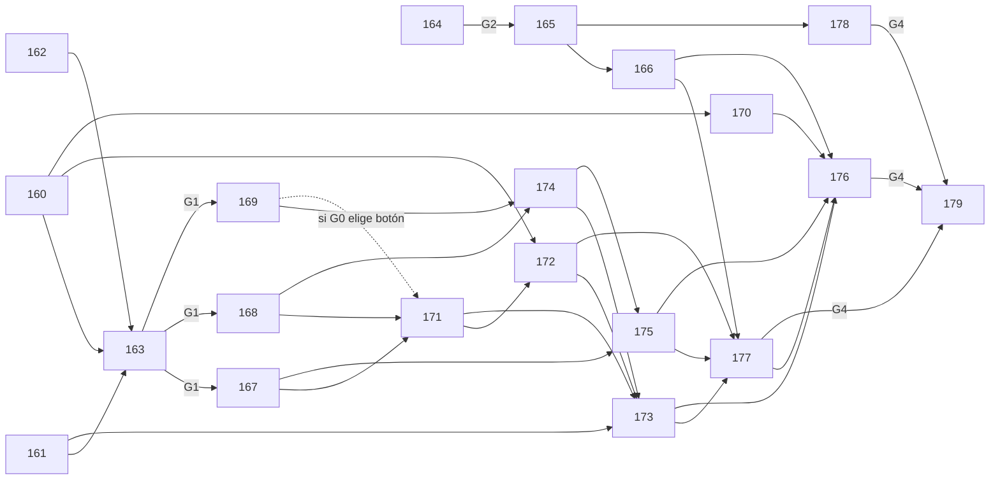

# Plan de M4 (alpha) — PUL-141

Fecha: 2026-10-13. Fuentes: `docs/design/roadmap.md` (alcance MoSCoW de la alpha), `decisions.md` (D1–D27),
`gdd.md` §11, features de `docs/design/features/`, `docs/arch/export.md` y el código de `godot/`.

## 1. Alcance de la alpha frente a lo hecho (M0..M3e)

| Alcance | Estado hoy | Lo que falta para la alpha | Ficha |
|---|---|---|---|
| Must 1 Paridad sin bugs + smoke en builds Win/Linux | Smoke automático en editor (PUL-025). `tools/export.sh` exporta Linux/Windows/Web (PUL-010) pero **Windows nunca se ha ejecutado**; tamaños medidos solo con la escena de arranque; sin icono, metadatos ni paquete | Preparar presets, versión y empaquetado (170); exportar los builds **finales** desde el commit de M4 con manifiesto (commit + SHA-256) y pasar el smoke sobre ellos (176); publicar esos mismos `.zip` (179) | PUL-170, PUL-176, PUL-179 |
| Must 2 Ciclo de comandas sin bugs (20 entregas, +1 exacto) | Tests de `OrderBoard`/e2e en verde | Comprobarlo en el build (no en el editor) | PUL-176 |
| Must 3 Paciencia por comanda | Hecho (M1) | Balance: `order_2` fase 3 56 s vs ~54 s de ruta (PUL-070) | PUL-164..166 |
| Must 4 Puntuación y estrellas | Hecho; umbrales 30/60/90 € provisionales, el bot saca 150–195 € (propuesta 40/90/150, `m3d-gate.md`) | Medir, decidir y aplicar | PUL-164..166 |
| Must 5 Coop 2P y mando | Hecho (M2) | Recorrido completo sin teclado incluyendo las pantallas nuevas (opciones, créditos) | PUL-171, 172, 177 |
| Must 6–7 Cambio de personaje, menú | Hecho | — (regresión en QA) | PUL-177 |
| Must 8 Comanda reducida (D25) | Hecho (M3d) | Precios y `presses_to_fill` provisionales (GDD §11.7) | PUL-164..166 |
| Must 9 Feedback y audio | Hecho (M3) | Escucha humana del audio: la tría PUL-139 (nota, no ficha de M4) | — |
| Must 10–11 Lenguaje de acciones y móvil (D26/D27) | Técnico hecho (PUL-121..138) | Playtest de M3e y export Android: **fuera de este plan** (PUL-150..154) | — |
| Should olla que se pasa | Hecho (PUL-069) | — | — |
| Should dificultad por fases | Hecho (PUL-070, 115) | Límites de fase provisionales (balance) | PUL-164..166 |
| Should opciones de volumen | Núcleo `AudioMix` + `AudioDirector.set_volume` (ADR-006 §2), **sin UI ni persistencia** | Spec de opciones, contrato, núcleo persistente, pantalla | PUL-160, 163, 167, 171 |
| Should textos en gallego | **Nada**: sin `[internationalization]` en `project.godot`, textos literales | Spec + glosario, contrato, claves, traducción, cambio en caliente | PUL-161, 163, 168, 173 |
| Should tutorial breve | Feature escrita (AC1–AC8, D25/D26), **sin implementar** | Cerrar flujo, contrato, núcleo, panel, montaje | PUL-162, 163, 169, 174, 175 |
| (Publicación) créditos y licencias | **No hay pantalla de créditos** y `licenses.md` registra 9 entradas CC BY (atribución obligatoria al distribuir) | Créditos con atribuciones y versión visible | PUL-160, 172 |
| (Publicación) versión, notas, subida | `config/version` = 0.1.0 | Versión de alpha, notas, publicación | PUL-179 |
| Puerta «Publicar alpha» | Sin guía | Guía del playtest y lista de comprobación | PUL-178 |
| Could (barro, gaiteros, habilidades, platos) | `eventos-de-entorno.md` escrita, nada implementado | **Sin ficha**: propuesta, fuera de la alpha (pregunta P7) | — |

No se duplican: defectos visuales sueltos, pendientes de fase 8/M1/M3/M3b (PUL-139 → PUL-142..149) ni cierre
de M3e, guía `m3e-gate.md` y export Android (PUL-140 → PUL-150..154).

## 2. Fichas (todas `draft`)

| Id | Rol | Título | Deps |
|---|---|---|---|
| PUL-160 | game-designer | Especificar opciones, créditos y versión visible | — |
| PUL-161 | game-designer | Poner al día textos en gallego y glosario | — |
| PUL-162 | game-designer | Cerrar el diseño del tutorial | — |
| PUL-163 | godot-architect | ADR-007 ajustes persistentes, localización y tutorial | 160, 161, 162 |
| PUL-164 | qa-tester | Medir el balance con el bot y proponer valores | — |
| PUL-165 | game-designer | Registrar el balance aprobado en el diseño | 164 (+ gate de balance) |
| PUL-166 | gameplay-engineer | Aplicar el balance en los `.tres` | 165 |
| PUL-167 | gameplay-engineer | Núcleo de ajustes persistentes y volumen guardado | 163 |
| PUL-168 | ui-engineer | Textos de la UI a claves de traducción (castellano) | 163 |
| PUL-169 | gameplay-engineer | Núcleo del tutorial y su fase en datos | 163 |
| PUL-170 | godot-architect | Preparar presets, versión (de G0) y empaquetado con manifiesto; solo ensayo, sin builds válidos | 160 |
| PUL-171 | ui-engineer | Pantalla de opciones (ajustes aprobados en G0) y, si G0 elige botón, botón «Tutorial» del menú | 167, 168, 169 (169 solo hace falta si G0 elige botón) |
| PUL-172 | ui-engineer | Créditos con licencias y versión visible | 160, 171 |
| PUL-173 | ui-engineer | Traducción al gallego y cambio en caliente | 161, 171, 172, 174 |
| PUL-174 | ui-engineer | Panel del tutorial | 168, 169 |
| PUL-175 | gameplay-engineer | Montar el tutorial en `level_01` con la entrada aprobada en G0 (única ficha que toca `level_01.tscn`) | 167, 174 |
| PUL-176 | qa-tester | Exportar los builds finales (commit limpio, manifiesto) y pasar el smoke Windows/Linux + rendimiento | 166, 170, 173, 175, 177 |
| PUL-177 | qa-tester | QA de M4 y preparar el playtest | 166, 172, 173, 175 |
| PUL-178 | game-designer | Guía del playtest y criterio de publicación (`m4-gate.md`) | 165 |
| PUL-179 | producer | Publicar la alpha: notas y subida de los `.zip` exactos del manifiesto de 176 (sin cambiar versión ni reexportar) | 176, 177, 178 (+ G4, G5) |

## 3. Oleadas (sin solapes de `owns` ni `touches_scenes` dentro de cada una)

| Oleada | Fichas | Notas de propiedad |
|---|---|---|
| O1 | 160, 161, 162, 164 | Solo docs de diseño distintos y evidencia/herramientas de medida |
| O2 | 163 · 165 · 170 | 163 tras O1 (diseño); 165 tras el **gate de balance**; 170 tras 160 (formato de licencias) y G0 (versión). 170 es dueña de `project.godot` **solo para `config/version`**, de los presets, `export.sh` y `docs/arch/export.md`; 163 de `ADR-007`, `signals.md`, `scene-tree.md` y `docs/arch/README.md` |
| O3 | 166, 167, 168, 169, 178 | 168 es dueña de `project.godot` (`[internationalization]`), de `data/i18n/**` y de las escenas de `ui/` (menús, HUD, tickets, táctil). Crea vacíos `options.*`, `credits.*`, `tutorial.*` para que O4/O5 no compartan fichero |
| O4 | 171, 174 | 171: `main_menu`/`pause_menu`/`options_menu.tscn`, `i18n/options.*` y, si G0 elige botón, el botón «Tutorial»; 174: `ui/tutorial/**`, `i18n/tutorial.*` |
| O5 | 172, 175 | 172: `main_menu`/`game_over`/`credits_menu.tscn`, `i18n/credits.*`; 175: `level_01.tscn`, `level.gd` |
| O6 | 173 | Dueña de todo `data/i18n/**` cuando ya existen todas las claves |
| O7 | 177 | QA en editor; los defectos bloqueantes se arreglan (fichas nuevas) antes de O8 |
| O8 | 176 | Export **final** desde el commit de integración limpio + smoke sobre esos `.zip`; manifiesto con commit y SHA-256. Solo evidencia |
| — | **Gate «Publicar alpha» (G4)** con `m4-gate.md` | Playtest humano con los `.zip` del manifiesto de 176 |
| O9 | 179 | `docs/release/**`; publicación de los `.zip` del manifiesto con confirmación explícita (G5) |

Ruta crítica: 160/161/162 → 163 (G1) → 168 → 171 → 172 → 173 → 177 → 176 → G4 → 179 (9 oleadas).
El balance (164 → G2 → 165 → 166) y la preparación de builds (160 → 170) van en paralelo y confluyen en 176/177.

**Identidad de los builds.** La versión se fija **antes** de exportar nada que se pruebe (170, valor de G0). Los builds
que se prueban, se juegan en G4 y se publican son los mismos: los genera 176 desde un commit con el árbol limpio y
los identifica `MANIFEST.txt` (commit, versión, SHA-256). Si después cambia algo en `godot/` o `tools/export.sh`,
176 se repite (y G4, si cambió el juego) antes de 179; 179 comprueba `git log <commit>..HEAD` vacío y los hashes.

## 4. Grafo de dependencias

## 5. Gates humanos

| Gate | Cuándo | Qué decide el responsable | Desbloquea |
|---|---|---|---|
| G0 Alcance de M4 | Antes de pasar O1 a `ready` | Preguntas P1–P5, P7 de abajo; en particular la **versión de la alpha** (P4), la **lista de opciones** (P2) y la **entrada al tutorial** (P5) | 160, 161, 162; 170 (versión); 171 y 175 (implementan solo lo elegido) |
| G1 Contratos (ADR-007) | Tras PUL-163 | Ajustes, formato de traducción, tutorial, señales nuevas | 167, 168, 169 |
| G2 Balance | Tras PUL-164 | Valores de umbrales, fases, paciencia, precios (lo registra el coordinador en `decisions.md`) | 165 → 166 |
| G3 Revisión del gallego | Tras PUL-173 | Que un hablante revise el texto (P9) | 176/177 en gallego |
| G4 «Publicar alpha» | Tras 176, 177 y 178 | Playtest con `m4-gate.md` sobre los `.zip` del manifiesto de 176: publicar, otra vuelta de balance o fichas nuevas (cualquier cambio de juego obliga a repetir 176 y G4) | 179 |
| G5 Subida | Dentro de 179 | Confirmación explícita antes de publicar fuera | publicación |

## 6. Preguntas abiertas para el responsable (antes de pasar fichas a `ready`)

- **P1 Idiomas.** ¿La alpha lleva castellano y gallego, solo esos dos? ¿El idioma por defecto es castellano
  (hoy `textos-gallego.md` AC3) o gallego, o se toma del sistema? ¿Inglés entra o no? → 161, 168, 173.
- **P2 Opciones mínimas.** ¿Solo volumen (3 buses) e idioma, o también pantalla completa/ventana, resolución,
  vsync, tilt-shift (D22 lo hace opcional), repetir tutorial, reasignar controles? Cada una añade AC → 160, 171.
  PUL-171 tiene como **propuesta** volumen ×3 + idioma y solo implementa la lista que apruebe G0 (si pasa de 5 AC, se parte).
- **P3 Plataformas.** ¿Builds de la alpha = Windows + Linux (Must 1)? ¿Se publica también el web? ¿En qué
  máquina se prueba Windows (no hay Windows ni Wine en el entorno de los agentes)? ¿Requisitos mínimos solo
  la RTX 3090 de D22 o también una gráfica integrada/portátil? → 170, 176.
- **P4 Criterio de «alpha publicada».** Número de versión (se fija en G0 porque PUL-170 lo escribe antes de exportar). ¿Dónde (itch.io privado/con enlace/público, carpeta compartida…), para
  quién (amigos, testers externos), con qué condición (todo Must en verde en ambas plataformas, N sesiones de
  playtest, 0 bloqueantes), y cómo se recoge el feedback? → 178, 179.
- **P5 Tutorial.** Es Should: ¿entra en la alpha? Si entra, ¿(a) automático en la primera partida, (b) botón en el menú
  o (c) ambos? PUL-175 implementa solo la opción elegida; si es b o c, el botón «Tutorial» es de PUL-171 (dueña del
  menú en O4, API en ADR-007). Si no entra, se cierran 162, 169, 174 y 175 sin hacer y se quitan de las deps de 171, 173, 176 y 177.
- **P6 Balance.** ¿Se acepta medir y decidir los valores antes del playtest (G2) o se prefiere decidirlos
  jugando en G4? ¿Margen mínimo de holgura por receta en su fase más dura (propuesta: ≥ 10 s)?
- **P7 Could.** ¿Barro, gaiteros (`eventos-de-entorno.md`), habilidades y platos quedan fuera de la alpha?
  (El plan asume que **sí quedan fuera** solo como propuesta: no hay fichas.)
- **P8 Windows sin firmar.** ¿Se acepta distribuir el `.exe` sin firma de código (aviso de SmartScreen)?
- **P9 Revisión del gallego.** ¿Quién revisa la traducción (el responsable u otra persona) y antes de qué gate?
- **P10 Playtests.** ¿Cuántas sesiones y con quién para G4 (solo el responsable, o jugadores externos)?

## 7. Riesgos

- La cadena de UI es secuencial por propiedad de escenas (`main_menu.tscn` pasa por 168 → 171 → 172): si P2
  amplía mucho las opciones, PUL-171 puede pasar de 5 AC y habría que partirla.
- PUL-168 toca muchas escenas de `ui/`: conviene que no coincida con fichas de PUL-142..154 que toquen HUD o
  tickets (el producer lo cruza al fijar oleadas).
- Rutas de `owns` de 167, 168, 169, 174 y 175 son provisionales hasta ADR-007 («Ficheros y campos»).
