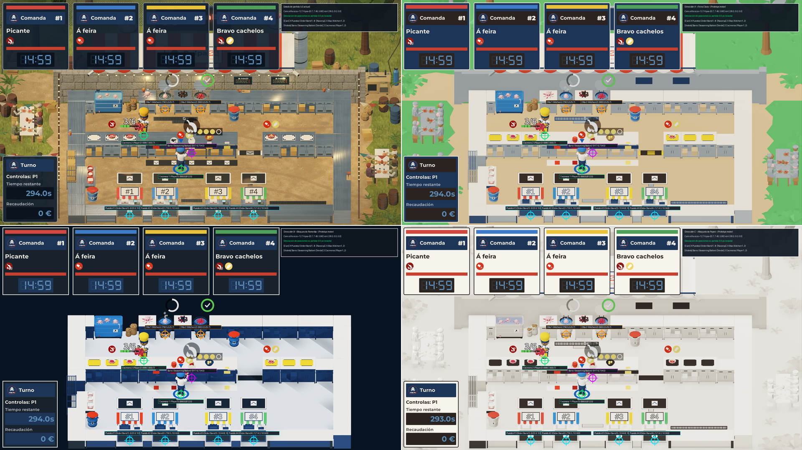
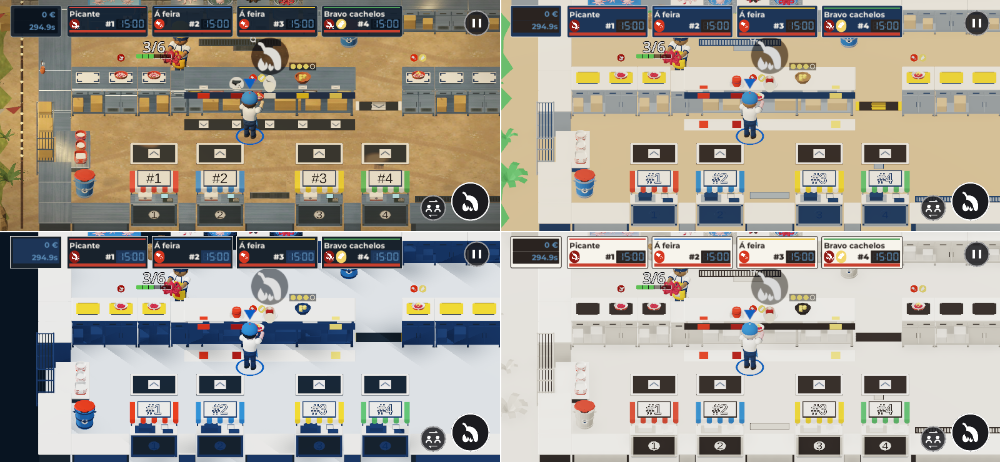

# Evidencia PUL-180 — Exploración de estética minimalista

Directorio de pruebas reproducibles para la ficha
[`docs/backlog/PUL-180-explorar-estetica-minimalista.md`](../../backlog/PUL-180-explorar-estetica-minimalista.md).
Todas las capturas corresponden a **prototipos ejecutados en tiempo de ejecución dentro de Godot 4.7.2**
sobre `godot/scenes/main/main.tscn`, sin modificar ninguna escena ni recurso versionado del proyecto.

---

## 1. Reproducción de las capturas y pruebas (AC1)

### Comando ejecutado
```bash
xvfb-run -a godot --audio-driver Dummy --path godot --resolution 1920x1080 \
  -s "$PWD/docs/evidence/PUL-180/capture_boot.gd" -- --out="$PWD/docs/evidence/PUL-180" \
  2>&1 | tee docs/evidence/PUL-180/capture_log.txt
```

- **Script de arranque:** [`capture_boot.gd`](capture_boot.gd) (carga autoloads y lanza `main.tscn`).
- **Script de estados y prototipos minimalistas en vivo:** [`capture_minimal.gd`](capture_minimal.gd)
  (adaptado a la caja única `res://resources/items/box.tres` y a la API `apply_seasoning`).
- **Script de cálculo de contrastes y anotación visual:** [`build_evidence.py`](build_evidence.py).
- **Registro completo de ejecución:** [`capture_log.txt`](capture_log.txt) — **0 líneas con `ERROR`**,
  salida limpia con código `0`.

### Archivos capturados
- **Estado de partida (`partida/`, estética v2 actual):**
  - [`partida/1920x1080_sin_hud.png`](partida/1920x1080_sin_hud.png)
  - [`partida/1920x1080_con_hud.png`](partida/1920x1080_con_hud.png)
  - [`partida/800x370_movil.png`](partida/800x370_movil.png)
- **Dirección A · «Feira Clara» (`direccion_a/`):**
  - [`direccion_a/1920x1080_sin_hud.png`](direccion_a/1920x1080_sin_hud.png)
  - [`direccion_a/1920x1080_con_hud.png`](direccion_a/1920x1080_con_hud.png) (copiada también en [`docs/art/minimal/direccion-a-color-plano.png`](../../art/minimal/direccion-a-color-plano.png))
  - [`direccion_a/800x370_movil.png`](direccion_a/800x370_movil.png)
- **Dirección B · «Bloques de Romería» (`direccion_b/`):**
  - [`direccion_b/1920x1080_sin_hud.png`](direccion_b/1920x1080_sin_hud.png)
  - [`direccion_b/1920x1080_con_hud.png`](direccion_b/1920x1080_con_hud.png) (copiada también en [`docs/art/minimal/direccion-b-geometrica.png`](../../art/minimal/direccion-b-geometrica.png))
  - [`direccion_b/800x370_movil.png`](direccion_b/800x370_movil.png)
- **Dirección C · «Maqueta de Papel» (`direccion_c/`):**
  - [`direccion_c/1920x1080_sin_hud.png`](direccion_c/1920x1080_sin_hud.png)
  - [`direccion_c/1920x1080_con_hud.png`](direccion_c/1920x1080_con_hud.png) (copiada también en [`docs/art/minimal/direccion-c-maqueta-papel.png`](../../art/minimal/direccion-c-maqueta-papel.png))
  - [`direccion_c/800x370_movil.png`](direccion_c/800x370_movil.png)

---

## 2. Verificación de contrastes de §3.4 (AC2)

El cálculo detallado de luminancia relativa WCAG 2.1 y las tablas completas por dirección se
encuentran en [`contrastes_sec34.md`](contrastes_sec34.md). Resumen de contrastes mínimos frente a
la superficie donde aparece cada condimento (requisito AC2: **≥ 3.00 : 1**):

| Condimento (§3.4) | Hex | Forma (D26) | Contraste en Dir. A | Contraste en Dir. B | Contraste en Dir. C | Cumple ≥ 3:1 |
|---|---|---|---|---|---|:---:|
| `paprika_sweet` (Pimentón dulce) | `#D6361F` | Círculo | **3.91 : 1** (sobre `#EDE8DF`) | **4.04 : 1** (sobre `#EFECE6`) | **4.34 : 1** (sobre `#F7F4EC`) | **SÍ** |
| `paprika_hot` (Pimentón picante) | `#8F1A14` | Octógono | **7.40 : 1** (sobre `#EDE8DF`) | **7.66 : 1** (sobre `#EFECE6`) | **8.21 : 1** (sobre `#F7F4EC`) | **SÍ** |
| `salt` (Sal gruesa) | `#F7F4EC` | Cuadrado | **11.24 : 1** (sobre `#1D3557`) / **6.14 : 1** (sobre `#B8283D`) | **11.24 : 1** (sobre `#1D3557`) / **14.12 : 1** (sobre `#18222C`) | **13.78 : 1** (sobre `#2A2320`) / **11.24 : 1** (sobre `#1D3557`) | **SÍ** |
| `oil` (Aceite de oliva) | `#F2C230` | Gota | **7.38 : 1** (sobre `#1D3557`) / **4.03 : 1** (sobre `#B8283D`) | **7.38 : 1** (sobre `#1D3557`) / **9.26 : 1** (sobre `#18222C`) | **9.04 : 1** (sobre `#2A2320`) / **7.38 : 1** (sobre `#1D3557`) | **SÍ** |
| `cachelos` (Cachelos) | `#F2D56B` | Óvalo | **8.54 : 1** (sobre `#1D3557`) / **4.67 : 1** (sobre `#B8283D`) | **8.54 : 1** (sobre `#1D3557`) / **10.72 : 1** (sobre `#18222C`) | **10.46 : 1** (sobre `#2A2320`) / **8.54 : 1** (sobre `#1D3557`) | **SÍ** |

---

## 3. Comprobación visual anotada de cámara y posiciones (AC3)

Los datos brutos de cámara y proyección 3D → 2D están exportados por el motor en
[`posiciones_verificadas.json`](posiciones_verificadas.json). La superposición visual anotada se
encuentra en [`comprobacion_posiciones_anotada.png`](comprobacion_posiciones_anotada.png) (escritorio
`1920×1080`) y la comparativa limpia de móvil en
[`comparativa_movil_800x370.png`](comparativa_movil_800x370.png):





### Tabla de coordenadas verificadas en `1920×1080` (`ortho_size = 12.74`, `pos = (0.7, 7.49, 5.86)`, `rot = (-38°, 0°, 0°)`)

| Grupo (AC3) | Nodo en escena | Posición mundo `(x, y, z)` | Pantalla `partida` `(px)` | Pantalla `Dir. A` `(px)` | Pantalla `Dir. B` `(px)` | Pantalla `Dir. C` `(px)` | Desviación máx. |
|---|---|---|---|---|---|---|---|
| **4 puestos** | `OrderStand1` (Puesto #1) | `(-3.3, 0.0, 5.75)` | `(620.9, 1034.6)` | `(620.9, 1034.6)` | `(620.9, 1034.6)` | `(620.9, 1034.6)` | **0.0 px** |
| **4 puestos** | `OrderStand2` (Puesto #2) | `(-1.3, 0.0, 5.75)` | `(790.5, 1034.6)` | `(790.5, 1034.6)` | `(790.5, 1034.6)` | `(790.5, 1034.6)` | **0.0 px** |
| **4 puestos** | `OrderStand3` (Puesto #3) | `(1.7, 0.0, 5.75)` | `(1044.8, 1034.6)` | `(1044.8, 1034.6)` | `(1044.8, 1034.6)` | `(1044.8, 1034.6)` | **0.0 px** |
| **4 puestos** | `OrderStand4` (Puesto #4) | `(3.7, 0.0, 5.75)` | `(1214.3, 1034.6)` | `(1214.3, 1034.6)` | `(1214.3, 1034.6)` | `(1214.3, 1034.6)` | **0.0 px** |
| **2 ollas** | `Kitchen` (Olla 1) | `(-1.3, 0.0, -4.0)` | `(790.5, 525.7)` | `(790.5, 525.7)` | `(790.5, 525.7)` | `(790.5, 525.7)` | **0.0 px** |
| **2 ollas** | `Kitchen2` (Olla 2) | `(0.7, 0.0, -4.0)` | `(960.0, 525.7)` | `(960.0, 525.7)` | `(960.0, 525.7)` | `(960.0, 525.7)` | **0.0 px** |
| **Barra** | `Bar_SeasoningStation` | `(0.2, 0.0, 0.0)` | `(917.6, 734.5)` | `(917.6, 734.5)` | `(917.6, 734.5)` | `(917.6, 734.5)` | **0.0 px** |
| **2 cocineros** | `Player1` (Cocinero 1) | `(-0.4, 0.0, 1.5)` | `(866.8, 812.5)` | `(866.8, 812.5)` | `(866.8, 812.5)` | `(866.8, 812.5)` | **0.0 px** |
| **2 cocineros** | `Player2` (Cocinero 2) | `(-2.5, 0.0, -1.6)` | `(688.7, 650.7)` | `(688.7, 650.7)` | `(688.7, 650.7)` | `(688.7, 650.7)` | **0.0 px** |
